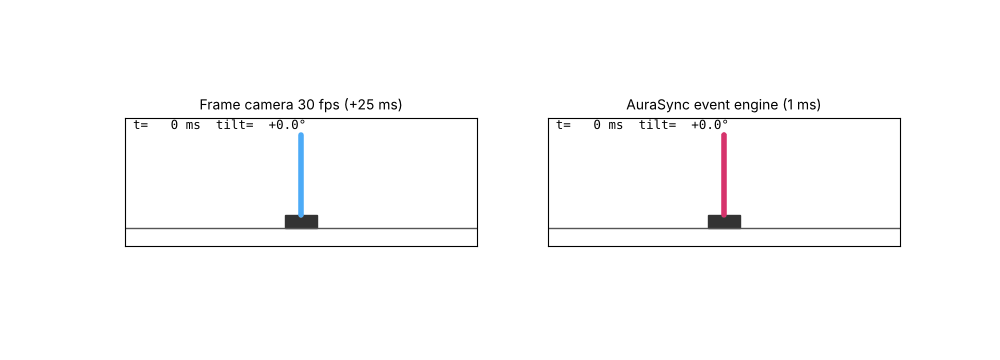
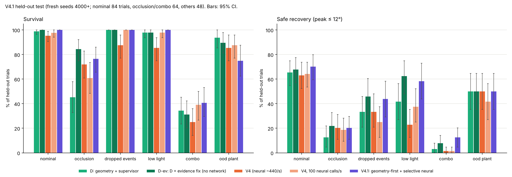
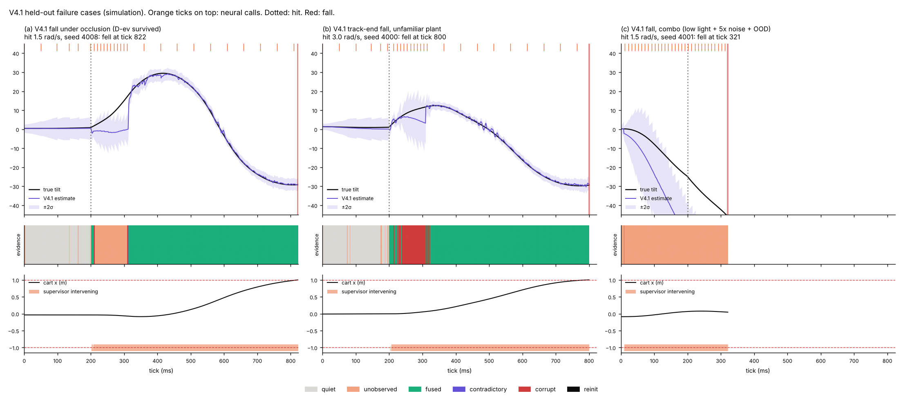
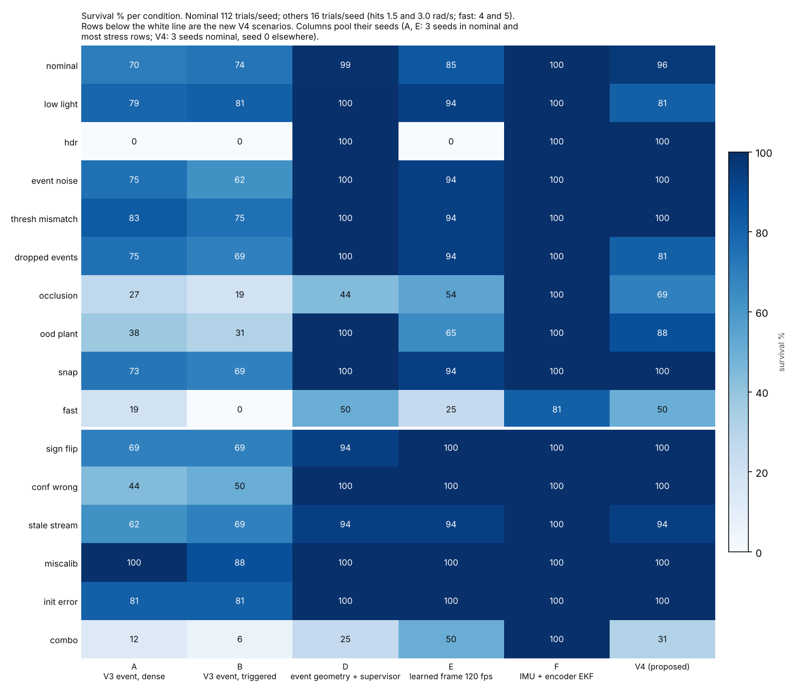
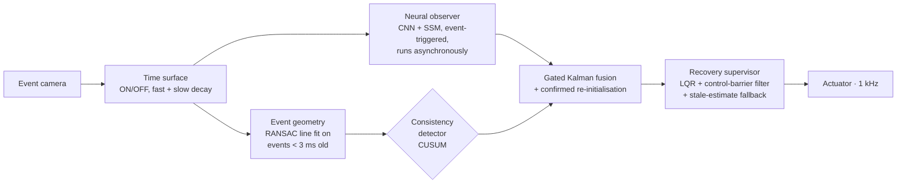
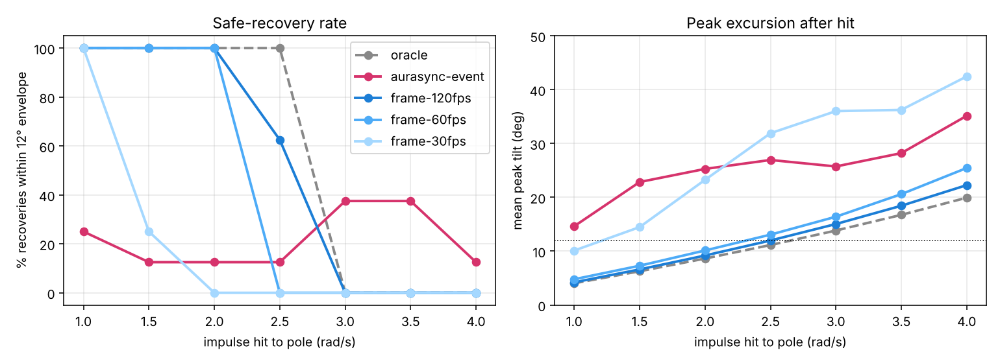
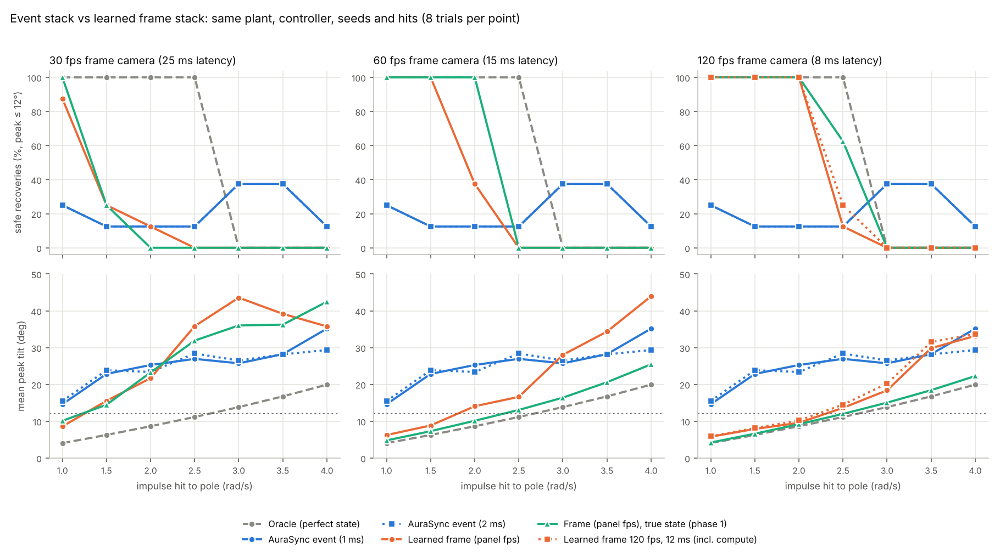
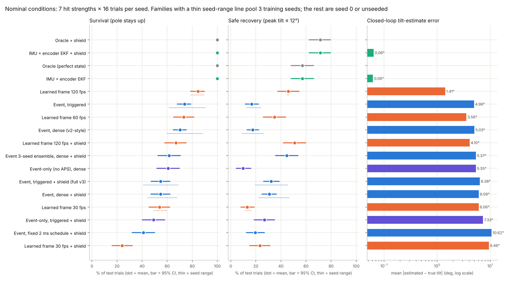
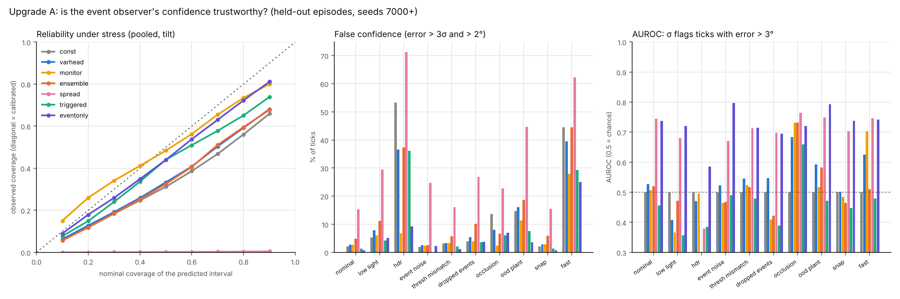
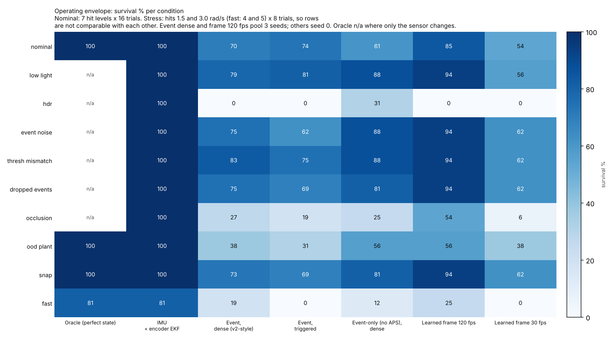

<div align="center">

# AuraKinetix · AuraSync-Engine

### Event-camera perception that knows when it is wrong

**An event-camera state estimator and controller for an inverted pendulum hit by sudden impulses.**
**It detects when its own estimate is confidently wrong, corrects it, and recovers.**




[Results](#-headline-results) · [V4.1 update](#-latest-v41-does-the-network-earn-its-place) · [How it works](#-how-it-works) · [Version history](#-version-history) · [Key findings](#-key-findings) · [Repository map](#-repository-map) · [Quick start](#-quick-start) · [Limitations](#-limitations--integrity)

</div>

---

## 🔭 Overview

Event cameras report brightness changes per pixel with microsecond timing instead of whole frames. That makes them
attractive for **fast recovery**: catching a system the moment it is knocked off balance.

AuraSync-Engine tests that idea end to end on a cart-pole:

> **events → time surface → physics-informed neural observer → 1 kHz controller → safety supervisor → actuator**

It was developed over four versions. Each one adds a capability and benchmarks it against fair baselines on
held-out test trials, with bootstrap confidence intervals.

The headline of the latest version (**V4: Detect → Correct → Recover**):
- **V3's problem:** its neural observer failed by becoming *confidently wrong*.
- **V4's fix:** it detects this within milliseconds, using independent event geometry, and corrects it.
- **Result:** nominal survival rises from **55% to 96%**.

> [!IMPORTANT]
> Every result in this repository comes from **simulation**: a simulated event camera, plant and sensors. No hardware
> result is claimed. The hardware-validation plan is in `versions/v4/docs/V4_HARDWARE_PLAN.md`.

---

## 🆕 Latest: V4.1, does the network earn its place?

V4 showed that a network-free geometry baseline matched it in most conditions. V4.1 tested this head-on:
- a **geometry-first, evidence-aware** estimator that tells *quiet*, *unobserved*, *contradictory* and *corrupt*
  evidence apart;
- **selective neural help**, called only when the geometry struggles (≤ 100 calls/s, gated, positions only);
- **evaluation on fresh held-out seeds** (4000+), with the design frozen beforehand.

<div align="center">

</div>

Paired differences over **272 held-out stress trials** (percentage points, 95% CI):

| Comparison | Survival | Safe recovery |
|:--|:--:|:--:|
| **Evidence fix alone** (D-ev vs D) | **+7.7 [+2, +13]** | **+9.2 [+4, +14]** |
| Network on top of the fix (V4.1 vs D-ev) | −1.8 [−7, +3] | −0.4 [−6, +5] |
| V4.1 vs V4 | **+7.7 [+2, +14]** | **+10.7 [+5, +17]** |

**The finding:** the evidence fix is the real gain, with occlusion survival rising from **45% to 84%** and no network
involved. **The selective neural assistant added no measurable benefit.** It reads the same blinded sensor as the
geometry, so it cannot supply what the geometry is missing.

The recommended default is now the network-free D-ev estimator. It needs **0.73 CPU cores**, against V4's 1.83.
Full analysis: **[`docs/V41_REPORT.md`](docs/V41_REPORT.md)**.

<details>
<summary><b>V4.1 failure cases</b></summary>
<br/>

</details>

---

## 📊 Headline results (V4)

<div align="center">

</div>

**Nominal conditions:** 7 hit strengths × 16 test trials per training seed. The test seeds were never used for any
design choice.

| System | Survival [95% CI] | Safe recovery (peak ≤ 12°) | Tilt-estimate error |
|:--|:--:|:--:|:--:|
| **V4: detect → correct → recover** | **96.4% [93, 99]** | **62.5%** | **1.22°** |
| V3: event observer + uncertainty + shield | 54.8% [47, 62] | 32.1% | 6.38° |
| V3: event observer, triggered | 73.8% [68, 79] | 16.7% | 4.96° |
| Learned frame camera, 120 fps | 84.5% [79, 90] | 45.8% | 1.41° |
| Event geometry + supervisor (no neural network) | 99.1% [97, 100] | 69.6% | 1.59° |
| IMU + wheel-encoder filter (reference) | 100% | 57.1% | 0.06° |

**Injected faults** (16 trials each):

| Fault | V3 + shield survival | V4 survival |
|:--|:--:|:--:|
| Estimate's angle sign flipped mid-recovery | 44% | **100%** |
| Confident 15° error injected | 38% | **100%** |
| Estimator starts 5° / 5 cm off | 50% | **100%** |
| Camera miscalibrated (1.2 px offset, 4% scale) | 50% | **100%** |

For these faults, V4's detector fires a median **4 ms** after the fault is injected. In the HDR scene (bright light
behind the pole), V4 survives **100%** of hits, where V3 and the frame camera survive **0%**.

---

## ⚙️ How it works



**An analogy.** The neural observer is a ship's navigator who dead-reckons. After a big wave he is sure of his
position, and wrong. V4 adds three things:
- a **lookout**, the event geometry, who takes direct bearings on the mast;
- a **rule for when to believe him**: the detector plus gated fusion, which resets only after several consistent
  bearings;
- a way to **warn the captain** (the safety supervisor) when nobody is sure.

---

## 🧭 Version history

| Version | What it added | What it showed |
|:--|:--|:--|
| [**v1**](versions/v1) | Event-camera simulator, time-surface encoder, physics-informed neural observer, 1 kHz LQR. Frame baselines were given the *true* state. | The full pipeline works end to end. The comparison was not fair yet: frame baselines got perfect state. |
| [**v2**](versions/v2) | A **learned** frame-camera estimator (30/60/120 fps) trained on the same data, for a fair comparison. | The event stack beat 30 fps, tied 60 fps and **lost to 120 fps** (70% vs 91% survival). |
| [**v3**](versions/v3) | Confidence-aware observer (variance head, ensemble, consistency monitor), CBF safety shield, event-triggered scheduling with deadlines, 3-seed benchmark, 9 stress conditions. | The learned confidence could not rank its own errors. The shield **lowered** survival on wrong estimates. Triggered scheduling matched dense at 45% of the compute. |
| [**v4**](versions/v4) | **Detect → Correct → Recover:** event-geometry measurement, CUSUM detector, gated correction, position-only neural fusion, re-tuned supervisor, 124-configuration benchmark, 6 fault scenarios, ablations, latency report. | Survival 55% → **96%**, and the injected faults are fixed. The network-free geometry baseline matches V4 in most conditions. |
| [**v4.1**](versions/v4.1) | **Geometry-first, evidence-aware estimation** with selective neural assistance (≤ 100 calls/s, gated, positions only). Exact reproduction check of V4, held-out evaluation on fresh seeds, CPU latency, failure cases. | The evidence fix gives **+7.7 survival / +9.2 safe recovery**, and occlusion goes 45% → 84%. **The network adds no measurable benefit** on top. New default: the network-free D-ev estimator. |

<details>
<summary><b>Earlier figures (v1 to v3)</b></summary>
<br/>

| v1 · recovery sweep | v2 · fair recovery sweep |
|:--:|:--:|
|  |  |
| **v3 · nominal benchmark** | **v3 · uncertainty study** |
|  |  |



</details>

---

## 🔬 Key findings

**What works**
- ✅ **Correction is the core of V4.** Removing it drops nominal survival from 96% to **8%**.
- ✅ **Position-only fusion.** Fusing only position from the neural observer, never its velocity, is the change that
  makes V4 work: 27% → 96% survival.
- ✅ **Triggered computation.** The neural correction runs at a third or less of its default rate (100 vs ~440
  calls/s) with no measurable loss.
- ✅ **The event sensor's edge.** HDR is where event sensing clearly beats frames: 100% vs 0% survival.

**What doesn't (reported, not hidden)**
- ⚠️ **The network is mostly redundant.** A network-free version (event geometry + supervisor) matches or beats V4
  in 14 of 15 non-nominal conditions, at about a sixth of the compute. The network clearly helps only when the
  pole is partly **occluded**.
- ⚠️ **Detection without correction is harmful.** Raising uncertainty without correcting the estimate is worse than
  doing nothing.
- ⚠️ **Open-loop error misled.** The design with the lowest estimation error had the worst control (27% survival).
- ⚠️ **Not real-time on one core.** Default V4 needs about 1.5 CPU cores of compute per second of control; a
  100 calls/s budget brings it to 0.58.
- ⚠️ **An IMU + wheel encoder still beats every camera** on this rig. Cameras matter when the moving object cannot
  carry a sensor.

The full analysis, with confidence intervals, ablations, failure case studies and limitations, is in
**[`docs/V4_REPORT.md`](docs/V4_REPORT.md)**.

---

## 🗂️ Repository map

```
AuraKinetix/
├── versions/
│   ├── v1/          event simulator, observer, LQR, first benchmark
│   ├── v2/          + learned frame-camera baseline (fair comparison)
│   ├── v3/          + uncertainty, safety shield, triggered scheduling, multi-seed benchmark
│   ├── v4/          + detect → correct → recover, full benchmark and docs
│       ├── aurasync/v4/        geometry, detector, V4 pipeline, geometry-only baseline
│       ├── benchmark_v4.py     baselines, ablations, stress conditions, fault scenarios
│       ├── analyze_v4.py       statistics and figures
│       ├── docs/               design, latency report, hardware-validation plan
│   │   └── results/v4/         raw results, report JSON, figures
│   └── v4.1/        + evidence-aware geometry, selective neural assistance, held-out test
├── docs/
│   ├── V4_REPORT.md            V4 technical report
│   └── V41_REPORT.md           V4.1 technical report
├── images/                     figures from every version
└── research-paper/             paper draft
```

Each version folder is self-contained and has its own README.

---

## 🚀 Quick start

```bash
git clone https://github.com/sahil03kundu-code/AuraKinetix.git
cd AuraKinetix/versions/v4.1
pip install torch numpy matplotlib

python -m unittest discover -s tests -v   # unit and integration tests
python analyze_v41.py                     # rebuild V4.1 tables and figures from the stored results
```

Re-running the V4.1 held-out benchmark (`python benchmark_v41.py`) takes about 1 hour; the V4 one, about 2 hours, on 2 CPU cores and can be
resumed if interrupted. The large training and development datasets are not in the repository; the scripts in each
version regenerate them.

---

## 🧪 Limitations & integrity

- **Simulation only.** The event camera, plant, noise and timing are all simulated. A configured 1 kHz control loop is
  **not** a demonstrated 1 ms sensor-to-actuator latency.
- **Sample size.** Stress and fault cells use 16 trials and mostly one seed, so differences under about 20 points
  there are not established.
- **Strict test protocol.** Design choices and tuning used validation seeds only. Test seeds were run once, after the
  design was frozen.
- **No novelty claims.** No comprehensive prior-art search has been done. Nothing here is claimed as first of its
  kind, formally safe, or better than existing methods outside this benchmark.

---

## 🛣️ Roadmap

1. **Real-sensor check:** record a real pendulum with an event camera and an encoder, and test the event-geometry
   measurement open loop.
2. ~~Make geometry the default and raise uncertainty when evidence goes missing~~: **done in V4.1**, which made
   occlusion survival go from 45% to 84%.
3. **Fix the issues V4.1 exposed:** tell real fast motion from sensor noise; never accept a helper's answer drawn
   from the same blinded sensor without corroboration; make the supervisor robust to plant changes.
4. **Closed-loop hardware validation**, following `versions/v4/docs/V4_HARDWARE_PLAN.md`.

---

<div align="center">

**Sahil Kundu** · B.Tech AI/ML, Techno India University

[](https://github.com/sahil03kundu-code)
[](https://www.linkedin.com/in/sahil-kundu-490724380)

<sub>If this project is useful to you, consider giving it a ⭐</sub>

</div>
