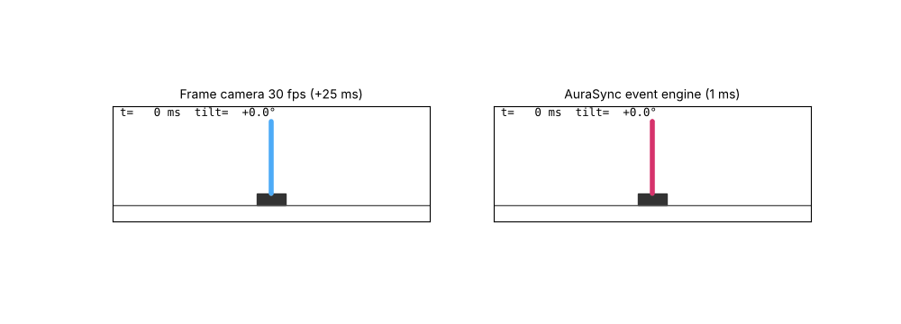
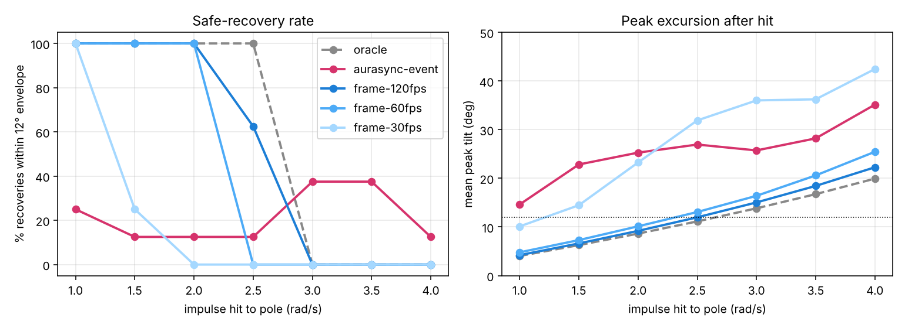

# AuraSync-Engine (simulation prototype)

An event-camera → physics-informed neural observer → 1 kHz controller stack that keeps an unstable
inverted pendulum upright and recovers it from sudden impulse "hits" and a mid-run mechanical failure.
It is benchmarked against conventional frame-camera pipelines on the same plant and controller.

Everything runs in simulation on a CPU. No real event sensor, RTOS or embedded hardware is involved yet.



## What is built

| Layer | File | What it does |
|---|---|---|
| Kinetic plant | `aurasync/physics.py` | Cart + 0.5 m pole (falls in ~160 ms), RK4 at 5 kHz, actuator limit 20 N, domain randomisation |
| Event camera | `aurasync/event_camera.py` | ESIM-style sensor: per-pixel log-intensity thresholds with mismatch, interpolated µs timestamps, background noise events, plus a slow 30 fps absolute (APS) frame like a DAVIS sensor |
| Event→tensor compression | `TimeSurfaceEncoder` | Fixed-memory exponential time surface (ON/OFF fast, any-polarity slow). Memory is constant (~49 KB) at any event rate, so nothing is buffered or dropped |
| Physics-informed observer | `aurasync/estimator.py` | Differentiable cart-pole physics predicts the next state; a CNN + sub-pixel spatial-softmax keypoint layer + selective (Mamba-style) SSM learns only the correction. The loss adds kinematic-consistency and correction-parsimony residuals |
| Controller | `aurasync/controller.py` | 1 kHz discrete LQR (the infinite-horizon limit of linear MPC), with saturation |
| HIL-style loop | `aurasync/simulate.py` | Plant 5 kHz, camera every substep, control 1 kHz; plug-in perception pipelines (oracle / event / frame) |

## Results (8 trials per point, `results/benchmark.json`)



**Honest read of the numbers:**

* **Against a 30 fps / 25 ms frame stack, the event stack holds up better on big hits.** At 3.0–3.5 rad/s it recovered inside the 12° safety envelope 38% of the time vs 0%, and its mean peak tilt is lower above 2.5 rad/s.
* **It is worse than 60/120 fps frame stacks and wobbles at rest.** Its mean peak tilt is already 15° on a gentle 1 rad/s hit. The cause is estimation accuracy (closed-loop tilt error ≈ 2°), not latency.
* **The frame baselines are deliberately generous.** They receive the *true* pose and velocity at each capture, so only their timing is realistic. A fair baseline needs a learned frame-based estimator too, and that would narrow the gap.
* **Measured latency is not sub-millisecond yet.** One perception tick (encode + observer) takes 1.83 ms median and 3.8 ms p99 in eager PyTorch on one CPU thread. The simulation assumes a 1 ms tick. Hitting < 1 ms needs TorchScript/ONNX + quantisation on a Jetson-class device.
* **Key research finding:** for this plant, 15–25 ms of frame latency costs less than 2° of estimation error. The bottleneck for event-based kinetic control here is *precision under silence*. An event camera sees nothing when nothing moves, which is why the slow APS frame channel was necessary.

What did and didn't work during development (checkpoints kept in `checkpoints/`):

| Version | Val tilt error | Closed loop |
|---|---|---|
| Events only | 2.0° (drifts 8° at rest) | balances, large drift |
| + 30 fps APS frame | 2.0° | fell in 2 of 4 tests |
| + spatial-softmax keypoints (final, step 2000) | **1.0°** | survives most hits, wobbles 5–15° |
| + DAgger on-policy fine-tune | 1.26° (worse) | discarded |

## Run it

```bash
pip install torch numpy scipy matplotlib
python generate_data.py              # ~1 min, 60k ticks of simulated events (~1.5 GB)
python train.py --steps 3000         # ~1.5–2 h on 2 CPU cores
python benchmark.py                  # latency + recovery sweep + snap test → results/
python make_demo.py                  # results/demo.gif
```

## Next steps, in order of payoff

1. Higher-resolution event sensor (real sensors are 640×480+; this sim uses 96×32), which directly attacks the 1° floor.
2. A learned frame-camera estimator baseline, for a fair comparison.
3. On-policy training done properly (more iterations, closed-loop selection metric).
4. Constrained MPC replacing LQR; TorchScript/ONNX + INT8 to get the tick under 1 ms.
5. Hardware: Prophesee/iniVation eval kit or DAVIS346 on a balancing rig.

## About the original concept document

The architecture, business model and patent claims in the concept document are untested ideas. This prototype is the first evidence, and it shows where the hard problem actually is. Treat speed claims like "< 0.8 ms" as targets until they are measured on hardware.
