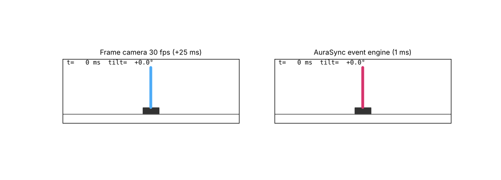
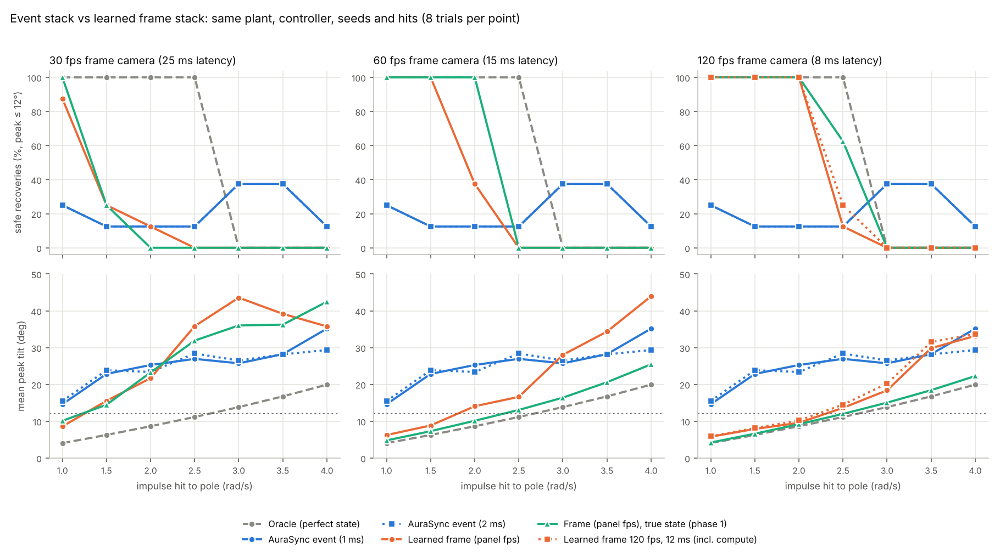

# AuraSync-Engine (simulation prototype)

An event-camera → physics-informed neural observer → 1 kHz controller stack that keeps an unstable
inverted pendulum upright and recovers it from sudden impulse "hits" and a mid-run mechanical failure.
It is benchmarked against a **learned** frame-camera stack on the same plant, controller, trajectories and hits.

Everything runs in simulation on a CPU. No real event sensor, RTOS or embedded hardware is involved yet.



## What is built

| Layer | File | What it does |
|---|---|---|
| Kinetic plant | `aurasync/physics.py` | Cart + 0.5 m pole (falls in ~160 ms), RK4 at 5 kHz, actuator limit 20 N, domain randomisation |
| Event camera | `aurasync/event_camera.py` | ESIM-style sensor: per-pixel log-intensity thresholds with mismatch, interpolated µs timestamps, background noise events, plus a slow 30 fps absolute (APS) frame like a DAVIS sensor |
| Event→tensor compression | `TimeSurfaceEncoder` | Fixed-memory exponential time surface; memory stays constant (~49 KB) at any event rate |
| Event observer | `aurasync/estimator.py` | Differentiable physics predicts the next state; CNN + sub-pixel spatial-softmax keypoints + selective (Mamba-style) SSM learn only the correction; physics-residual loss terms. 273k params |
| **Frame camera + estimator (phase 2)** | `aurasync/frame_camera.py` | Global-shutter camera on the same 96×32 scene with exposure motion blur and read noise. `FrameEstimator`: ResNet-lite trunk over the last 3 frames + the same per-frame keypoint encoder, conditioned on frame rate and exposure. 464k params |
| Frame pipeline | `LearnedFramePipeline` | Each frame's estimate is rolled forward through the same nominal physics, replaying the controls applied since capture, to cover its latency (a Smith predictor); it keeps propagating at 1 kHz between frames. `mode="zoh"` = naive hold |
| Controller | `aurasync/controller.py` | 1 kHz discrete LQR (infinite-horizon limit of linear MPC) with saturation |
| HIL-style loop | `aurasync/simulate.py` | Plant 5 kHz, sensors every substep, control 1 kHz; plug-in perception pipelines |

## Phase 2: fair baseline. Does the event camera beat a frame camera?

Phase 1's frame baselines were handed the **true** state at capture time. In phase 2 the frame stack has to estimate
the state from blurred, noisy pixels, exactly as the event stack does from events. Both learned models were trained on
**the same 40 simulated trajectories** and validated on the same 6. Every pipeline was then run on the same
56 hit trials (7 hit strengths × 8 seeds) plus 8 mechanical-snap trials.



### Headline numbers (`results/benchmark_fair.json`)

Survival is the share of the 56 hit trials in which the pole did not fall. Differences are paired by trial and given
with 95% bootstrap confidence intervals.

| Frame stack (latency budget) | Frame survival | Event survival | Event − frame survival | Event − frame mean peak tilt |
|---|---|---|---|---|
| Learned 30 fps (25 ms) | 52% | 70% | **+18 pts [+7, +30]** | −3.1° [−6.7, +0.3] |
| Learned 60 fps (15 ms) | 75% | 70% | −5 pts [−12, +2] (tie) | +3.8° [−0.4, +7.7] |
| Learned 120 fps (8 ms) | 91% | 70% | **−21 pts [−32, −11]** | +8.6° [+4.7, +12.2] |
| Learned 120 fps (12 ms, incl. its own compute) | 86% | 70% | **−16 pts [−27, −7]** | +7.8° [+3.6, +11.7] |

### What the fair comparison shows

1. **Event beats a 30 fps camera, ties 60 fps and loses clearly to 120 fps.** That stays true even when the
   120 fps stack is charged an extra 4 ms for its own inference. "Event cameras outperform frame cameras under
   high-speed motion" is therefore **not** supported in general by this prototype, only against slow cameras.
2. **Per frame, the frame estimator is the more precise sensor.** Validation tilt error at capture time is 0.29–0.40°,
   against 1.0° for the event observer. In closed loop the 120 fps stack tracks tilt to 1.3° on average across the
   sweep, the event stack to 5.7°. The event stack's 1 ms freshness doesn't make up for that.
3. **The phase-1 baseline was misleading in both directions.** It flattered 60/120 fps cameras: with the true state
   they survived 100% of trials, while learned they survive 75% and 91%. But it *understated* the 30 fps gap: the event
   stack only tied the 30 fps true-state baseline (+2 pts), yet beats the learned one by +18 pts.
4. **Motion blur made no measurable difference here.** 1 ms and 4 ms exposures gave the same results to within
   2 pts survival at every frame rate. At 96×32 px and these speeds, blur is not what limits frame cameras. Blur
   immunity, the classic event-camera argument, is **not demonstrated** by this simulation.
5. **Latency compensation is what makes slow cameras usable.** At 30 fps, rolling the estimate forward through physics
   lifts survival from 29% (naive hold) to 52%. At 120 fps it is neutral (91% vs 96%, within noise).
6. **Compute cost cuts both ways.** One event tick costs 1.8 ms median on one CPU thread, but it must run 1,000 times
   a second. That is 180% of a core, so it would not keep up in real time on this CPU. One frame estimate costs
   5.6–6.0 ms (p99 9–10 ms), but at 120 fps that is only ~70% of a core. Real-time event processing will need an
   optimised runtime or a much smaller model.

Full table (survival / safe-within-12° / mean peak tilt / mean closed-loop tilt-estimate error):

| Pipeline | Survival | Safe | Peak | Est. error | Snap survival |
|---|---|---|---|---|---|
| Oracle (perfect state) | 100% | 57% | 11.5° | 0° | 100% |
| AuraSync event, 1 ms | 70% | 21% | 25.5° | 5.7° | 100% |
| AuraSync event, 2 ms | 68% | 21% | 25.0° | 6.0° | 100% |
| Learned frame 120 fps | 91% | 45% | 16.9° | 1.3° | 100% |
| Learned frame 120 fps, 12 ms | 86% | 46% | 17.7° | 1.7° | 100% |
| Learned frame 60 fps | 75% | 34% | 21.7° | 3.4° | 100% |
| Learned frame 30 fps | 52% | 18% | 28.6° | 6.6° | 75% |
| Learned 30 fps, naive hold | 29% | 0% | 39.0° | 7.3° | 0% |
| Learned 30 fps, 1 ms exposure | 52% | 20% | 28.2° | 6.5° | 75% |
| True-state frame 120 / 60 / 30 fps (phase 1) | 100 / 100 / 68% | 52 / 43 / 18% | 12.5 / 14.0 / 27.8° | — | 100 / 100 / 100% |

Peak tilt includes trials where the pole fell (counted at about 46°), so survival is the cleaner metric.

### Limits a reviewer will raise

* 8 trials per point (56 per pipeline), one training seed per model. Confidence intervals are given, but multi-seed
  training and more trials are needed before a paper.
* The models differ in size (273k vs 464k params) and training budget. The event model's APS channel is a sharp
  30 fps frame, which slightly favours the event stack.
* Latency budgets (8/15/25 ms) are assumptions, not measured sensor timings.
* Simulated scene, simulated sensors, one plant.

## Phase 1 history

Phase 1 results (event vs true-state frame baselines) are kept in `results_phase1/`. During development:

| Event-observer version | Val tilt error | Closed loop |
|---|---|---|
| Events only | 2.0° (drifts 8° at rest) | balances, large drift |
| + 30 fps APS frame | 2.0° | fell in 2 of 4 tests |
| + spatial-softmax keypoints (final, step 2000) | **1.0°** | survives most hits, wobbles 5–15° |
| + DAgger on-policy fine-tune | 1.26° (worse) | discarded |

## Run it

```bash
pip install torch numpy scipy matplotlib
python generate_data.py              # event dataset (~1 min, ~1.5 GB)
python train.py --steps 3000         # event observer (~1.5–2 h on 2 CPU cores)
python generate_frame_data.py        # frame dataset on the same trajectories (~1.5 min)
python train_frame.py --steps 5000 --batch 32   # frame estimator (~27 min)
python benchmark_fair.py             # phase-2 fair benchmark (~25 min) → results/benchmark_fair.json
python benchmark.py                  # phase-1 benchmark (true-state baselines)
python make_demo.py                  # results/demo.gif
```

## Next steps, in order of payoff

1. **Close the event stack's estimation gap.** It is now the clear bottleneck (5.7° vs 1.3° closed-loop tilt error).
   Higher-resolution event sensor (real ones are 640×480+), a matched training budget, multi-seed runs.
2. Scenarios where events should win: faster motion, finer resolution, low light, high dynamic range. Then re-test blur.
3. Constrained MPC; TorchScript/ONNX + INT8 so the event tick actually fits 1 ms.
4. Hardware: a Prophesee/iniVation eval kit or DAVIS346 on a balancing rig.
