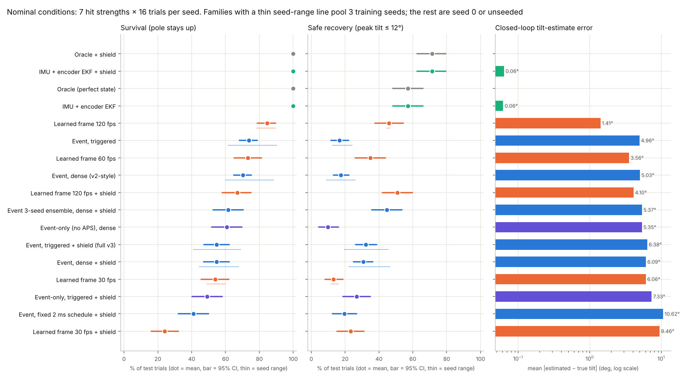
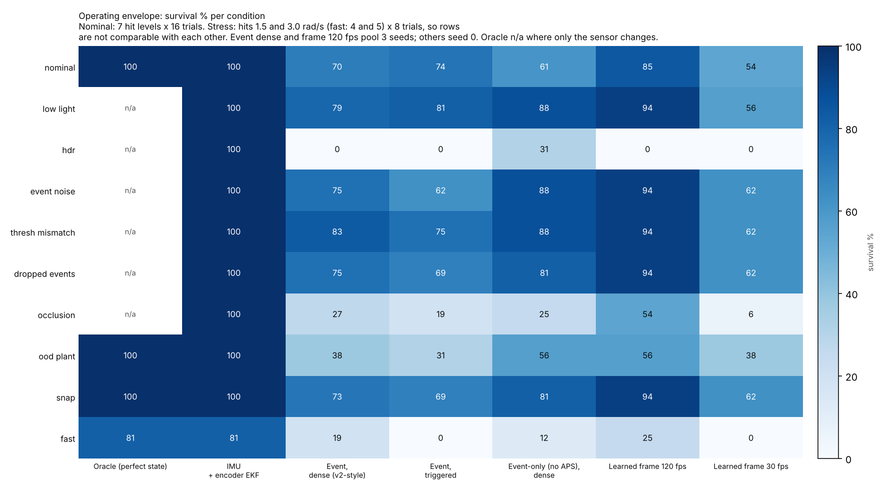
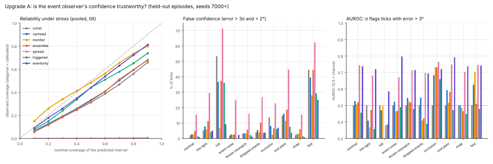

# AuraSync-Engine v3 (simulation prototype)

An event-camera → physics-informed neural observer → 1 kHz controller stack that keeps an unstable
inverted pendulum upright through sudden impulse "hits", benchmarked against learned frame cameras,
an IMU + encoder filter and a perfect-state oracle.

Everything runs in simulation on a 2-core CPU. No real event sensor, RTOS or embedded hardware is involved.

v3 adds the four upgrades requested for v2:

| Upgrade | What was built | Verdict |
|---|---|---|
| **A** Confidence-aware observer | Variance head + event-activity inputs (`ProbEventObserver`), 3-seed deep ensemble, physics-propagated covariance, and a new model-free **event-consistency monitor** | The learned confidence is calibrated on average but **cannot tell good estimates from bad ones** and misses the observer's main failure. The monitor and the ensemble do catch it. |
| **B** Safety shield | Robust discrete control-barrier-function filter with uncertainty margin, delay compensation, hard/soft priorities, fallback (`aurasync/safety.py`) | Works **only with an accurate state**: with perfect state or IMU, safe recoveries 57% → 71% at no survival cost. On every learned estimator it **lowers survival** (event −16 pts, frame 120 fps −22 pts). |
| **C** Event-triggered scheduling | Physics prediction every tick, asynchronous neural correction with measured latency, triggers, deadline accounting (`aurasync/scheduler.py`) | Background corrections at the CPU's real rate (448/s, 0 deadline misses) **match the dense observer at 45% of the compute**. The triggers themselves never held a correction back, so no extra saving. |
| **D** Stronger benchmark | 3 training seeds, matched protocol, validation/test split, event-only + IMU baselines, 9 stress conditions, paired bootstrap CIs and effect sizes | Learned 120 fps frames beat the event stack in **8 of 10** conditions. HDR is the one condition where an event design wins, and only **without** the APS frame channel. An IMU + encoder beats every camera everywhere. |

## Headline numbers (nominal conditions, `results/v3/v3_report.json`)

Test trials: 7 hit strengths × 16 trials per training seed (seeds 500–515, never used for any choice).
Survival = the pole did not fall; safe = also stayed within 12°. 95% bootstrap CIs over trials.



| Stack | Seeds | Survival | Safe | Closed-loop tilt error |
|---|---|---|---|---|
| Oracle (perfect state) | – | 100% | 57% | 0° |
| Oracle + shield | – | 100% | 71% | 0° |
| IMU + encoder EKF | – | 100% | 57% | 0.06° |
| IMU + encoder EKF + shield | – | 100% | 71% | 0.06° |
| Learned frame 120 fps | 3 | 85% [79, 90] (seeds 79–89) | 46% | 1.41° |
| **Event, triggered (v3, no shield)** | 3 | **74% [68, 79]** (seeds 62–90) | 17% | 4.96° |
| Learned frame 60 fps | 1 | 73% | 35% | 3.56° |
| Event, dense (v2-style) | 3 | 70% [65, 75] (seeds 60–88) | 18% | 5.03° |
| Event 3-seed ensemble + shield | – | 62% | 45% | 5.37° |
| Event-only (no APS), dense | 1 | 61% | 10% | 5.35° |
| Event, triggered + shield (all upgrades on) | 3 | 55% [47, 62] | 32% | 6.38° |
| Learned frame 30 fps | 3 | 54% [46, 62] | 13% | 6.06° |

Paired comparisons (same trials, matched training seeds; Cohen's h for rates):

| Comparison | Survival difference | Safe difference |
|---|---|---|
| Event triggered vs event dense (C) | +3.6 pts [−1, +8] | −0.9 [−4, +3] |
| Shield on the event stack (B) | **−15.5 pts [−22, −9]**, h = −0.32 | +13.1 [+9, +18] |
| Shield on frame 120 fps (B, seed 0) | **−22.3 pts [−30, −14]**, h = −0.56 | +4.5 [−2, +11] |
| Event triggered vs frame 120 fps | **−10.7 pts [−16, −5]**, h = −0.27 | −29.2 [−36, −22] |
| Event dense vs frame 120 fps | −14.3 pts [−19, −9] | −28.3 [−35, −22] |
| 3-seed ensemble vs single model (both shielded) | +6.8 pts [+3, +11] | +14.0 [+7, +21] |
| IMU + encoder vs learned frame 120 fps | +15.5 pts [+10, +21], h = +0.81 | +11.3 [+7, +17] |

## Operating envelope (Upgrade D)



Stress trials: hits of 1.5 and 3.0 rad/s (fast: 4 and 5) × 8 trials. Event dense and frame 120 fps pool
3 seeds; the other columns are seed 0.

| Condition | Event dense − frame 120 fps survival (3 seeds) | Verdict |
|---|---|---|
| Nominal | −14 pts [−19, −9] | frame wins |
| Low light | −15 [−27, −4] | frame wins |
| HDR (bright window behind the pole) | 0 (both 0%) | both fail; **event-only survives 31%** (+31 pts [+12, +56] vs event+APS, seed 0) |
| Event noise ×10 | −19 [−35, −4] | frame wins |
| Threshold mismatch ×3 | −10 [−21, 0] | frame wins |
| 50% dropped events | −19 [−31, −8] | frame wins |
| Occlusion (100 ms) | −27 [−48, −8] | frame wins |
| Unseen plant parameters | −19 [−33, −2] | frame wins |
| Mechanical snap (pole mass ×1.8) | −21 [−31, −8] | frame wins |
| Very fast hits (4–5 rad/s) | −6 [−19, +4] | no significant difference |

What this bounds:
* **The event stack performs like a 60 fps camera** (74% vs 73%) and beats a 30 fps camera, but loses to 120 fps.
* **The only event win is HDR, and only without the APS frame.** The 30 fps APS channel saturates exactly like a frame camera
  and drags the event+APS model down with it. Removing it is the single most useful design change v3 found.
* **For this rig, a low-cost MEMS IMU + wheel encoder beats every camera in every condition** (0.06° tilt error vs 1.4°+). Cameras
  only make sense when the moving object cannot carry a sensor (a robot watching a tool, a part, another machine).
* Sensor faults that only touch events (×10 noise, ×3 threshold mismatch, 50% dropped events) did **not** measurably hurt the
  event stack: +1 to +9 pts against nominal at the same hit strengths, within noise. The large losses are occlusion, unseen
  dynamics, very fast motion and HDR.

## Upgrade A: is the observer's confidence trustworthy?

Two studies. **Open-loop** (`eval_uncertainty.py`): 10 conditions × 4 held-out episodes (seeds 7000+), every method on
identical sensor data. **Closed-loop failure warning** (`eval_divergence.py`): the 112 test trials of seed 0, with all
warning signals recorded, and thresholds fixed on validation seeds for ≤5% false alarms.



1. **After temperature scaling on validation, the variance head is calibrated on average** (nominal 1σ / 2σ coverage 66% / 87%,
   ideal 68% / 95%). Raw, it was over-confident by 2.3× on tilt.
2. **But it cannot rank its own errors.** AUROC for flagging ticks with > 3° error is 0.53 nominal, 0.47 in HDR: chance level,
   no better than a constant error bar.
3. **It misses the observer's dominant failure.** After large hits the observer can drift to a wrong, even mirror-image, angle
   (true +46° while estimating −5°) while its σ stays at 1–3°: errors of 20–40 σ.
4. **The new event-consistency monitor** (`aurasync/monitor.py`) checks the estimate against raw events: fresh events should land
   on the predicted pole. It needs no training and is independent of the network.
   * Open-loop false confidence (error > 3σ and > 2°): HDR 37% → **6.7%**, occlusion 8.1% → **2.5%**, fast hits 40% → 28%.
   * Closed-loop failure warning (event + shield, 62 failures): **catches 100% of falls, median 130 ms ahead (worst case 39 ms)**,
     16% false alarms. The learned σ catches 53%.
   * Without the shield (42 failures), at about 5% false alarms, all signals catch only about a third of falls
     (σ 29%, ensemble spread 36%, monitor 38%). Some failures look like recoverable runs until very late.
5. **Ensemble spread** (3 seeds in shadow) ranks errors well (AUROC 0.67–0.77, except HDR 0.38) and gave the earliest warning
   (100% caught, median 324 ms ahead, with the shield), but its raw scale is far too small, so it is a detector, not a calibrated σ.
   The 3-seed ensemble mean is also more accurate (1.10° vs 1.31° open-loop) and survived +6.8 pts more than a single model.
6. **The event-only model's own σ ranks errors best of all methods** (AUROC 0.70–0.80, except HDR 0.59) and it was the most accurate open-loop
   (0.98° nominal, 2.0° vs 5.9° in HDR).
7. **In triggered mode, uncertainty propagated through the physics is the best calibrated** (expected calibration error
   0.026–0.036 in 6 of 10 conditions; it degrades in HDR, unseen dynamics and fast hits).

## Upgrade B: safety shield

`ShieldedController`: estimate → delay compensation (replay the controls applied since the estimate's time) → stale check →
LQR → robust discrete CBF filter → actuator. Closed form for one input, about 0.16 ms of always-on tick cost including physics and LQR.

The shield took four design fixes, each found on validation or diagnostic runs before the final test:
1. **Priority inversion.** The soft 12° target outranked the track limit and drove the cart off the track in 21% of perfect-state
   runs. Hard limits (track end, pole near falling) now always come first.
2. **Over-cautious cart barrier.** A fixed look-ahead blocked the motion needed to catch the pole. It is now a braking-distance
   barrier: position plus stopping distance at 12 m/s² must stay inside the track.
3. **Chasing an unreachable target.** After a hit too big to contain, pursuing 10° only spent track. The soft target is now
   gated by reachability (|ψ| ≤ 2 ψ_max) …
4. … **and latched until settled.** Re-arming mid-recovery made the shield fight the controller.
   When no command can be certified, it now does no harm and passes the LQR command through.

Result: with a perfect or near-perfect state, survival is 100% on every test hit (up to 4 rad/s; identical to LQR up to
5 rad/s on validation runs) and safe recoveries rise 57% → 71%. **With any learned estimate it lowers survival** (event
−15.5 pts, frame 120 fps −22 pts, frame 30 fps −29 pts at seed 0). The shield acts on wrong estimates, and its interventions push the system into states where the
observer was never trained, which makes divergence more likely. A safety filter is only as good as the state it is given.
The validation-tuned uncertainty margin (κ) came out at 0 for the event and frame families, so in this setup the
uncertainty tightening did not help either.

## Upgrade C: event-triggered computation with a deadline guarantee

Measured on this CPU, one thread, idle (`results/v3/latency.json`):

| | p50 | p95 | p99 | max |
|---|---|---|---|---|
| Neural event correction | 1.64 ms | 2.61 ms | 3.20 ms | 7.83 ms |
| Frame estimator | 5.33 ms | 7.85 ms | 9.59 ms | 13.08 ms |
| Always-on tick (physics + covariance + LQR + shield) | 0.16 ms | 0.33 ms | 0.40 ms | 3.39 ms |

* A neural correction cannot run every 1 ms on this CPU, so the v2 "dense" observer was never real-time. v3 runs it in the
  background; the 1 ms loop never waits for it and only uses cheap physics prediction between results.
* Deadline: a correction not finished within 6 ticks is discarded and the covariance keeps growing (deterministic fallback).
  **0 deadline misses** in all benchmark runs.
* At the rate the CPU can sustain (448 corrections/s, 45% of dense), survival is equal to or better than dense on every seed
  (62/70/90% vs 60/62/88%; +3.6 pts [−1, +8]). Open-loop tilt error on validation episodes: 1.08° vs 1.06°.
* **The trigger policy itself added nothing.** A correction takes 2 or more ticks, so the burst/doubt triggers (56%/44% of starts)
  fired the moment the worker was free, exactly like a fixed 2 ms schedule (identical results on seed 0). Stricter triggers
  (≈380/s) scored slightly worse on validation. No regime was found where gating saves compute without cost.
* Python's worst-case tick (3.4 ms) shows this is not hard real-time; that needs C++/Rust on an RTOS.

## Protocol (Upgrade D)

* **Seeds:** event observer 0/1/2, frame estimator 0/1/2, event-only 0. Same data, step budget and checkpoint-selection rule.
  The event models differ a lot in closed loop (dense survival 60–88%) despite similar validation error (0.89–1.05°),
  so multiple seeds are necessary.
* **Splits:** training seeds 1000–1039; validation 9000–9005 (checkpoint selection, calibration) and closed-loop seeds 300–315
  (shield and trigger tuning); test 500–515 / 800–807 (closed loop) and 7000–7003 (open loop). Unseen plant regime
  (masses +45/55%, length +16%) only at test.
* **Matched tuning:** every family got the same shield grid on the same validation runs. The event family has extra
  trigger knobs, which turned out not to matter.
* **Statistics:** paired by trial (same hit, initial state, sensor-noise seed) and restricted to the training seeds both sides share.

## Limits

* Simulation, one plant, a 96×32 sensor; real event cameras are 640×480+ and their noise differs.
* Stress conditions use 16 trials per seed and mostly seed 0, so many CIs span ±20–30 pts.
* The first shield design was found faulty on test-seed results (priority inversion). It was fixed, re-tuned on validation only,
  and all shielded configurations were re-run; the faulty results are kept in `results/v3/stale_shield_v0/` for transparency.
* The monitor's baseline (m0 = 0.25) partly reflects its starting value during quiet validation stretches.
* Unshielded benchmark timings are not real-time measurements; the latency table above is the reference.

## Files

| File | Purpose |
|---|---|
| `aurasync/estimator.py` | `ProbEventObserver` (v3): variance head, activity input, gap-aware corrections |
| `aurasync/scheduler.py` | Dense / greedy / periodic / triggered pipelines, latency model, deadline handling |
| `aurasync/safety.py` | CBF safety shield and `ShieldedController` |
| `aurasync/monitor.py` | Event-consistency monitor |
| `aurasync/conditions.py` | Stress conditions shared by both cameras |
| `aurasync/imu.py` | IMU + encoder EKF baseline |
| `train_v3.py`, `run_v3_training.sh` | Multi-seed, resumable training |
| `tune_v3.py` | Latency, calibration, shield and trigger tuning (validation only) |
| `benchmark_v3.py`, `analyze_v3.py` | Closed-loop benchmark and statistics |
| `eval_uncertainty.py`, `eval_divergence.py` | Upgrade A studies |

```bash
python3 generate_data.py && python3 generate_frame_data.py        # datasets (convert to .npy for memory-mapped training)
./run_v3_training.sh                                              # ~9 h on 2 cores, resumable
STAGE=all python3 tune_v3.py
python3 eval_uncertainty.py && python3 eval_divergence.py
python3 benchmark_v3.py && python3 analyze_v3.py                  # ~5 h on 2 cores, resumable
```

## Next steps, in order of payoff

1. **Drop the APS frame channel** (event-only won the only event-favourable condition) and retrain at higher resolution.
2. **Turn the monitor into a correction, not just a warning:** fit the pole angle directly to the fresh events and re-anchor the
   observer when the monitor fires. It already gives 39–324 ms of warning before falls.
3. **On-policy training** (DAgger) on shielded and failing trajectories, to remove the distribution shift that both the shield and
   large hits expose.
4. Re-test the shield only once the estimator's error is closer to the IMU's.
5. Move the always-on loop to C++/Rust for hard real-time.

## History

* **v1:** event stack vs frame baselines handed the true state (`results_phase1/`).
* **v2:** learned frame baseline. Event beat 30 fps, tied 60 fps, lost to 120 fps (`results/benchmark_fair.json`).
* **v3:** this document.
