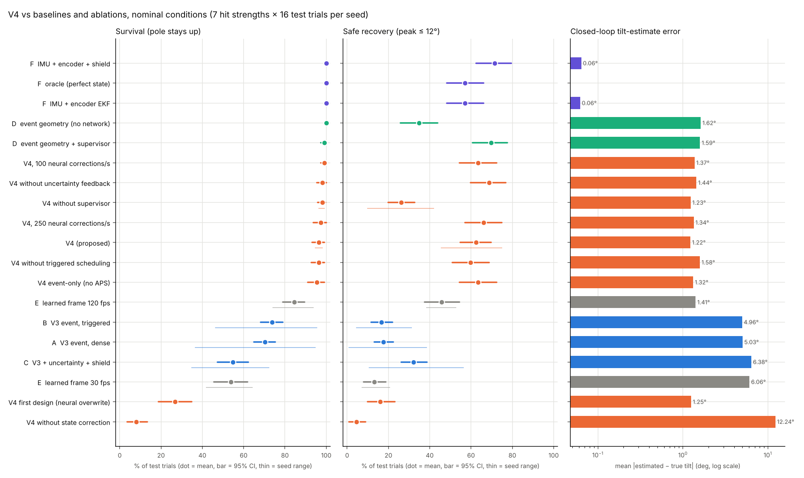
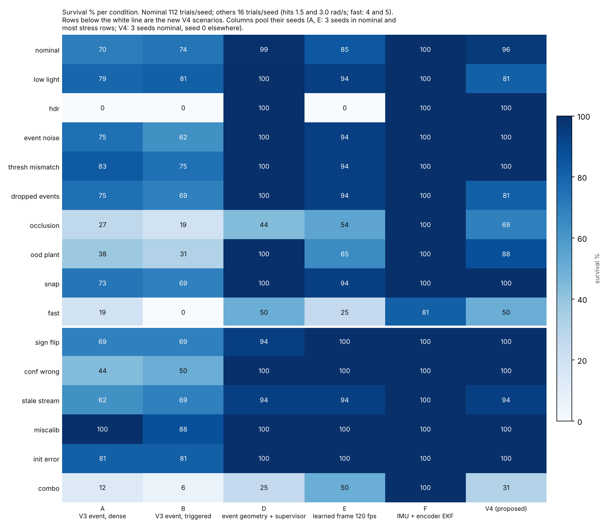

# AuraSync-Engine V4 — Detect → Correct → Recover (simulation prototype)

An event-camera state estimator and controller for an inverted pendulum (cart-pole) that
is hit by sudden impulses. V4 adds a way to **detect** when the learned observer is
confidently wrong, **correct** it from independent event geometry, and **recover** with
an uncertainty-aware safety supervisor.

**Everything here runs in simulation on a 2-core CPU.** No hardware result is claimed.
The V3 README is in `docs/V3_README.md`.

## The idea in one analogy
The V3 neural observer is a ship's navigator who dead-reckons. After a big wave he is
sure of his position, and wrong. In V3, that was the cause of every fall.

V4 adds three things:
- **a lookout** who takes direct bearings on the mast: a RANSAC line fit on events less
  than 3 ms old;
- **a rule for when to believe him:** a CUSUM consistency detector plus a gated Kalman
  update, with re-initialisation only after several consistent bearings;
- **a way to warn the captain** (the supervisor) when nobody is sure.

## Headline results (test seeds, never used for any choice)



| Nominal, 112 trials/seed | Survival [95% CI] | Safe (≤ 12°) | Tilt error |
|---|---|---|---|
| **V4 proposed** (3 seeds) | **96.4 [93, 99]** | **62.5** | 1.22° |
| C: V3 + uncertainty + shield (3 seeds) | 54.8 [47, 62] | 32.1 | 6.38° |
| B: V3 triggered (3 seeds) | 73.8 [68, 79] | 16.7 | 4.96° |
| E: learned frame camera 120 fps (3 seeds) | 84.5 [79, 90] | 45.8 | 1.41° |
| **D: event geometry + supervisor, no network** | **99.1 [97, 100]** | **69.6** | 1.59° |
| F: IMU + encoder | 100 | 57.1 | 0.06° |

**What holds up:**
- **V4 vs V3 + shield:** survival +41.7 points [+34, +49], safe recovery +30.4
  [+23, +37].
- **Faults V3 cannot survive:** V4 survives the injected sign flip and the confident
  15° error on 16/16 trials (V3 + shield: 44% and 38%). Its alarm fires a median 4 ms
  after the fault.
- **HDR:** 100% survival, where V3 and the frame camera get 0%.

**What does not:**
- **Baseline D**, the same detect-and-correct idea without the neural network, is level
  with or better than V4 in 14 of 15 non-nominal conditions. In nominal conditions its
  safe recovery is 7.1 points higher [2, 13], at a sixth of the compute.
- **Occlusion** is the only condition where V4 is clearly ahead (69% vs 44% survival).
- **Correction is essential.** Detection plus uncertainty inflation without it is worse
  than V3: 8% nominal survival.
- **Uncertainty inflation** showed no benefit.
- **The first V4 design** (the network overwrites the state) had the lowest error and
  27% survival.
- **Compute:** default V4 needs about 1.5 CPU cores of compute per second of control.

Full report with CIs, ablations, failure analyses and limitations:
**[`docs/V4_REPORT.md`](docs/V4_REPORT.md)**.



## Repository map

| Path | What it is |
|---|---|
| `aurasync/v4/geometry.py` | Module A: EventGeometry, the RANSAC pole-line measurement |
| `aurasync/v4/pipeline.py` | Modules A–C, E: `ConsistencyDetector`, `V4Pipeline` (gated fusion, confirmed re-init, inflation, position-only neural fusion, compute budget) |
| `aurasync/v4/geo_pipeline.py` | Baseline D: physics + gated geometry, no network |
| `aurasync/safety.py` | Module D: CBF supervisor, delay compensation, stale fallback (from V3) |
| `benchmark_v4.py` | Test benchmark: baselines A–F, V4, ablations, 9 stress conditions, 6 new fault scenarios |
| `analyze_v4.py` | Statistics (paired bootstrap CIs, Cohen's h) and figures → `results/v4/v4_report.json` |
| `v4/repro_v3.py` | Step 2: bit-exact V3 reproduction |
| `v4/collect_dev.py`, `v4/eval_dev.py` | Steps 3–5: validation failure catalogue and open-loop detector/correction evaluation |
| `v4/select_v4.py`, `v4/tune_v4.py` | Step 6: design selection and supervisor tuning (validation seeds 300–315 only) |
| `v4/latency_v4.py` | Module E: per-stage timings |
| `v4/plot_failures.py`, `v4/plot_test_cases.py` | Failure visualisations (validation and test) plus per-tick CSV logs |
| `tests/test_v4.py` | Unit and integration tests |
| `docs/` | V3 audit, V4 design, latency report, technical report, hardware-validation plan |

## Reproduce
```bash
pip install torch numpy scipy matplotlib --break-system-packages
python3 -m unittest discover -s tests -v       # 12 tests; 4 need the V3 checkpoints + dev set
python3 v4/repro_v3.py                         # V3 reproduction check
python3 v4/collect_dev.py && python3 v4/eval_dev.py     # validation set (about 3.4 GB in data/)
python3 v4/select_v4.py && python3 v4/tune_v4.py        # selection and tuning (validation only)
WHICH=all python3 benchmark_v4.py              # test benchmark, resumable (about 2 h on 2 cores)
python3 analyze_v4.py                          # tables, CIs, figures
python3 v4/latency_v4.py                       # timings (run on an idle CPU)
```
Runs are deterministic (fixed seeds, 1 thread per worker), and the V3 checkpoints in
`checkpoints/v3/` are reused unchanged. Rules that hold throughout:
- **Ground truth:** estimators never read it. Replay tests pass `s_true=None`.
- **Configuration:** stored in `results/v4/tuning_v4.json` (supervisor),
  `checkpoints/v3/calibration.json` and `results/v3/tuning.json` (inherited).

## Integrity notes
- **Simulation only.** No real event sensor, actuator or timing hardware.
- **Latency.** The 1 kHz control loop is not a demonstrated 1 ms sensor-to-actuator
  latency. See `docs/V4_LATENCY.md`.
- **No priority claims.** No prior-art search was done, and nothing here is claimed as
  first of its kind, formally safe or patentable.
- **Sample size.** Stress and scenario cells use 16 trials and mostly one seed, so
  differences below about 20 points there are not established.
